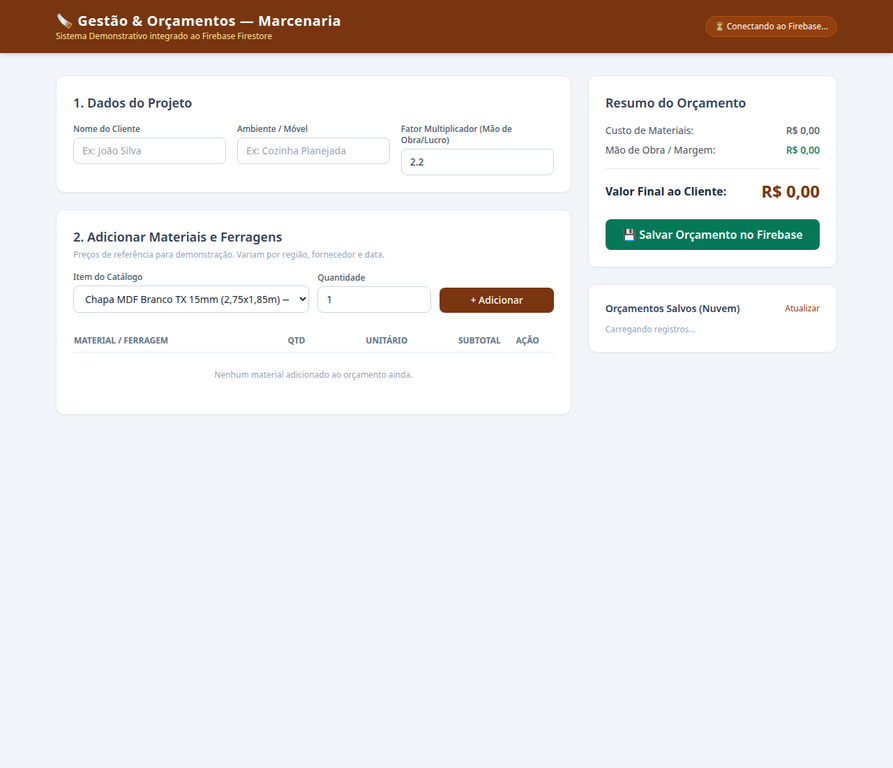
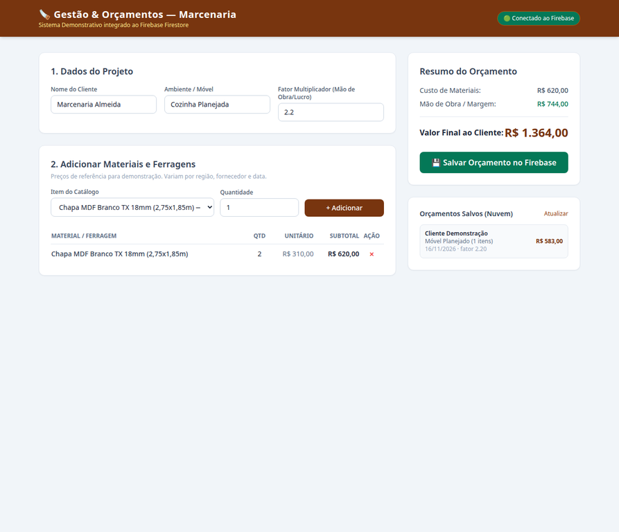

<p align="center">
  
</p>

<p align="center">
  <strong>Sistema web demonstrativo para gestão e cálculo automático de orçamentos de marcenaria.</strong>
</p>

<p align="center">
  <a href="https://taliaalmeida.github.io/sistema-marcenaria/"></a>
  
</p>

<p align="center">
  
  
  
  
</p>

> **01 // PROJECT_OVERVIEW**  
> O Sistema Marcenaria transforma a precificação de móveis planejados em um fluxo direto: o usuário seleciona insumos e ferragens do catálogo, o sistema calcula o custo dos materiais, aplica um fator multiplicador para mão de obra e margem de lucro e salva o orçamento na nuvem.

## 02 // RECURSOS

| Recurso | Descrição |
| --- | --- |
| **Catálogo de insumos** | Chapas de MDF, fitas de borda, colas e parafusos com valores de referência do mercado. |
| **Catálogo de ferragens** | Corrediças, dobradiças, pistões e puxadores. |
| **Custo de materiais** | Calcula automaticamente o total dos itens selecionados. |
| **Fator multiplicador** | Aplica mão de obra e margem de lucro sobre o custo dos materiais. |
| **Histórico de orçamentos** | Salva e consulta orçamentos na nuvem com Firebase Firestore. |

## 03 // INTERFACE

As capturas abaixo mostram a aplicação publicada: a tela inicial, com o catálogo de insumos e ferragens, e um orçamento preenchido com o cálculo de materiais, margem e valor final.

### Tela inicial

<p align="center">
  
</p>

### Orçamento preenchido

<p align="center">
  
</p>

<p align="center"><sub>Capturas reais da aplicação publicada, utilizando dados de demonstração.</sub></p>

## 04 // STACK E ARQUITETURA

| Camada | Tecnologia/abordagem |
| --- | --- |
| Interface | HTML5 e Tailwind CSS. |
| Comportamento | JavaScript com ES Modules. |
| Dados | Firebase Cloud Firestore para o histórico de orçamentos. |
| Cálculo | Soma dos materiais multiplicada pelo fator de mão de obra e margem. |
| Publicação | GitHub Pages. |

## 05 // COMO USAR

### Demo online

Acesse [taliaalmeida.github.io/sistema-marcenaria](https://taliaalmeida.github.io/sistema-marcenaria/).

### Execução local

```bash
git clone https://github.com/taliaalmeida/sistema-marcenaria.git
cd sistema-marcenaria
```

Abra o arquivo `index.html` no navegador. O projeto é um único arquivo e precisa de conexão com a internet para carregar o Tailwind CSS e o Firebase.

Se o navegador bloquear algum recurso ao abrir o arquivo diretamente, use um servidor local:

```bash
python3 -m http.server 8000
```

Depois, abra [http://localhost:8000](http://localhost:8000). Alternativas: `npx serve .` ou a extensão Live Server do VS Code.

### Fluxo recomendado

1. Escolha os insumos e ferragens no catálogo.
2. Informe as quantidades de cada item.
3. Defina o fator multiplicador de mão de obra e margem.
4. Confira o custo de materiais e o valor final do orçamento.
5. Salve o orçamento e consulte-o depois no histórico.

## 06 // SOBRE OS VALORES

Os preços do catálogo são valores de referência do mercado e servem para demonstrar o cálculo. Eles variam por região, fornecedor e data. Para uso real, atualize os valores antes de gerar orçamentos.

## 07 // CONFIGURAÇÃO E SEGURANÇA

O projeto utiliza Firebase no lado do cliente. A configuração do app é pública por natureza, então a proteção dos dados depende das regras do Firestore, versionadas em `firestore.rules`: leitura pública, criação com validação de campos e tamanhos, e edição/exclusão bloqueadas. Os textos vindos do banco são escapados antes de serem exibidos.

Para publicar as regras (a aplicação é publicada pelo GitHub Pages):

```bash
firebase deploy --only firestore:rules
```

Como a leitura é pública, não use dados reais de clientes na demonstração. Nunca publique credenciais administrativas ou tokens em commits e screenshots.

## 08 // ESTRUTURA

```text
sistema-marcenaria/
├── index.html                  # Interface, estilos e lógica da aplicação
├── firebase.json               # Configuração do Firebase (regras do Firestore)
├── firestore.rules             # Regras de segurança do banco
├── .firebaserc                 # Projeto Firebase associado
├── tela-inicial.webp           # Captura da tela inicial
├── orcamento-preenchido.webp   # Captura de um orçamento preenchido
└── README.md                   # Documentação do projeto
```

## 09 // ROADMAP

| Prioridade | Evolução sugerida |
| --- | --- |
| Alta | Implementar autenticação e regras do Firestore por usuário, restringindo a leitura. |
| Alta | Permitir edição e exclusão de orçamentos salvos. |
| Média | Exportar o orçamento em PDF para envio ao cliente. |
| Média | Permitir cadastro e atualização de preços pelo próprio usuário. |
| Média | Adicionar testes para o cálculo de custos e do fator multiplicador. |

## 10 // AUTORIA

Desenvolvido por **Natalia Almeida — By Natalia Dev**.

- [Demo online](https://taliaalmeida.github.io/sistema-marcenaria/)
- [Código-fonte](https://github.com/taliaalmeida/sistema-marcenaria)
- [Perfil no GitHub](https://github.com/taliaalmeida/taliaalmeida)
- [Instagram](https://www.instagram.com/nataliaalmeidatech)

<p align="center">
  <sub>Learn. Build. Automate. Evolve.</sub>
</p>
